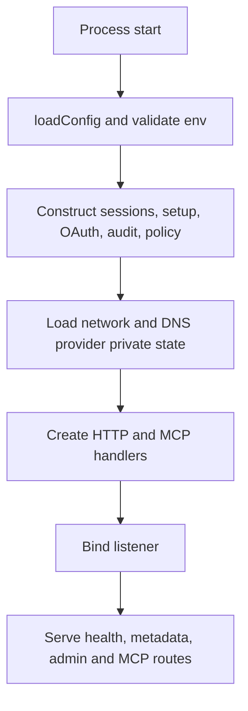
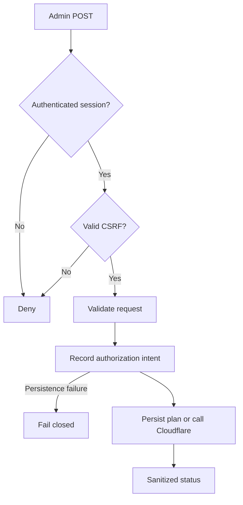

# Runtime and Request Execution Flows

## Initialization

The diagram represents the previously inspected application factory and startup configuration. The exact current entrypoint invocation and initialization ordering require fresh source verification.

## First-admin onboarding

Installation issues a one-time setup token. Before account initialization, the server rejects protected login/OAuth/MCP operations and exposes a restricted setup endpoint. The first account password becomes a hash in private state; a separate durable completion marker stops the setup flow reopening after account-state loss.

## Administrator mutation

**Important:** Not all older admin routes necessarily use the same durable-audit gate; the explicit before-write ordering was observed for network plan and new Cloudflare mutation routes. Review each route before assuming universal transactional behavior.

## Provider mutation semantics

Cloudflare record changes use the configured zone ID, validate the payload, and on edit/delete re-read the target record before the mutation. A stale `expectedContent` mismatch rejects the change. Cloudflare and local audit storage are **not a single distributed transaction**; a successful remote operation followed by a local failure may require reconciliation.
