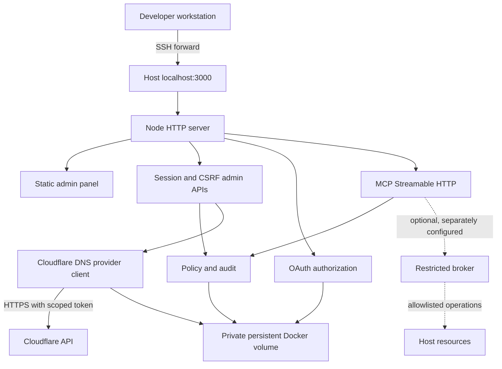

# Architecture Overview

The observed project is a **single Node.js/TypeScript server** with three adjacent concerns: MCP service, administrator website/API, and an opt-in restricted privileged broker code path. Docker Compose provides a private default deployment; a separate broker is not enabled by the default stack.

The arrows show responsibility and trust boundaries; they are **not** an automatically deployed public HTTPS topology.

## Startup shape

- `src/index.ts`: application entrypoint in the previously inventoried tree.
- `src/shared/config.ts`: validated startup configuration.
- `src/server/http.ts`: HTTP routing, public metadata, admin endpoints, MCP integration and static UI serving.
- `src/server/mcp.ts`: tool registration / per-request policy-dependent MCP dispatch.
- `src/security/*`: setup, auth, OAuth, session, policy, audit, approval and network/provider state.
- `src/tools/*`: individual tool handlers.
- `public/*`: UI assets.
- `scripts/*` + `compose.yaml`: deployment lifecycle.

## Classification

- **Implemented:** private admin panel, OAuth/MCP server, read-only tools, persisted policy, Cloudflare DNS admin integration (mock-tested), installer, backup and restore.
- **Conditional / internal:** broker-mediated Docker and deployment inspections/writes.
- **Not turnkey:** automatic public SSL issuance/renewal, domain purchase/registrar management, ready-to-use ChatGPT cloud OAuth, arbitrary shell/root access.

Refer to [internal module map](modules.md), [execution flow](execution-flow.md) and [permission guide](../guides/access-control.md).
