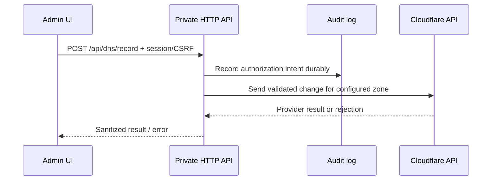

# Cloudflare DNS Provider Integration

## Intended integration

The earlier inspected version added `src/security/cloudflare-dns.ts`, `CloudflareDns`, and admin-only routes for one Cloudflare zone. Records managed through the panel are **real Cloudflare records**, not local drafts. Automated tests mocked the Cloudflare API; a real provider token/zone was **not** tested in the available evidence.

### Supported record operations

| Type | Supported action | Inputs |
| --- | --- | --- |
| A | Create / edit / delete | IPv4, name, TTL, optional proxy |
| AAAA | Create / edit / delete | IPv6, name, TTL, optional proxy |
| CNAME | Create / edit / delete | Name, target host, TTL, optional proxy |
| TXT | Create / edit / delete | Name, text, TTL; no proxy |
| MX | Create / edit / delete | Name, mail target, TTL, required priority; no proxy |

The previous provider implementation allowed listing up to 1,000 records and displayed unsupported types read-only. It checked in-zone record names and re-read records before updates/deletes, using previously displayed content to reject stale edits. Confirm these behaviors on the live revision.

## Trust boundaries

- API base was fixed to `https://api.cloudflare.com/client/v4/`, not a user-entered URL.
- Token/Zone ID are submitted only to admin-session/CSRF-protected connection endpoint.
- The token is stored privately in `MCP_DNS_PROVIDER_FILE`, and is not returned by the status endpoint.
- The previous installer stored provider state at `/data/dns-provider.json` in a private Docker volume; backup/restore includes that file.
- Backups are not automatically encrypted: encrypt them before off-server transfer.
- The provider token must be limited to an authorized zone with appropriate Zone Read + DNS Edit permissions.

## Operator-to-provider flow

Do **not** treat DNS provisioning as automatically enabling TLS: domain ownership, DNS propagation, certificate issuance, gateway configuration and external OAuth callbacks remain independent concerns.

See exact [HTTP request shapes](../api/http.md) and [failure codes](../api/errors.md).
