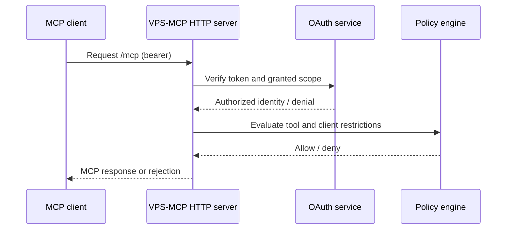

# Remote MCP Integration and OAuth

## Two transports, two trust domains

The **web dashboard** is an operator UI protected by a login session. The **MCP server** is reached at `POST /mcp` using an OAuth bearer token. A browser-session cookie does not grant automatic MCP access, and the admin's Cloudflare DNS API routes are **not** MCP tools.

The observed implementation used MCP Streamable HTTP, authorization-code + PKCE S256, restricted client registration, explicit OAuth redirects, scopes `vps:read` and `vps:write`, and separately managed permission ceilings.

### Auth/transport sequence

**Illustrative flow only:** exact call structure and token errors must be checked against the current source before integration certification.

## Private vs remotely reachable

The private Compose origin was `http://127.0.0.1:3000`. ChatGPT or another cloud client cannot directly reach your laptop's SSH tunnel or VPS loopback. A public HTTPS origin or a supported secure tunnel must be designed, **including browser-accessible OAuth authorization**.

Do **not** fix remote connectivity by publishing an unauthenticated `0.0.0.0:3000` listener, disabling Host/Origin checks, or mounting a host Docker socket into the web API.

## Integration checklist

1. Verify the target MCP client supports the server's Streamable HTTP/OAuth flow.
2. Provide a transport that makes the resource endpoint and OAuth authorization reachable from the correct actors.
3. Configure the exact callback URI from the client; the observed registration flow rejected unallowlisted redirects.
4. Temporarily open OAuth enrollment in the authorized admin panel, if required by the client's dynamic registration flow.
5. Request read-only scopes initially, verify tool discovery, then revoke a test client and verify the old token is rejected.
6. Test reconnect/refresh after restart; access tokens were described as process-local in earlier implementation notes.

**Not verified:** end-to-end ChatGPT cloud OAuth login, external HTTPS/TLS gateway and secure-tunnel deployment on an actual VPS. Do not advertise a one-command ChatGPT connection.

See [HTTP routes](../api/http.md), [access-control semantics](access-control.md), and [limitations](../audit/coverage-and-validation.md).
